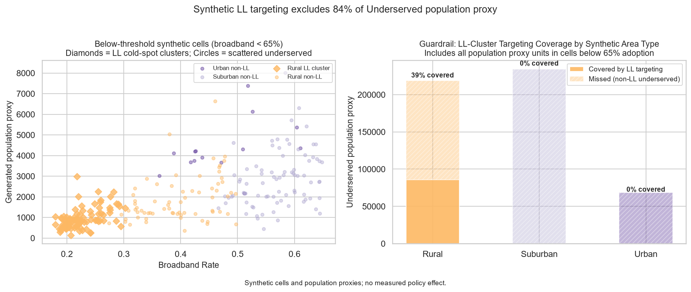
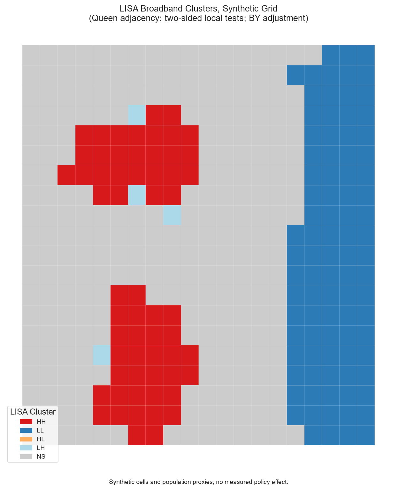
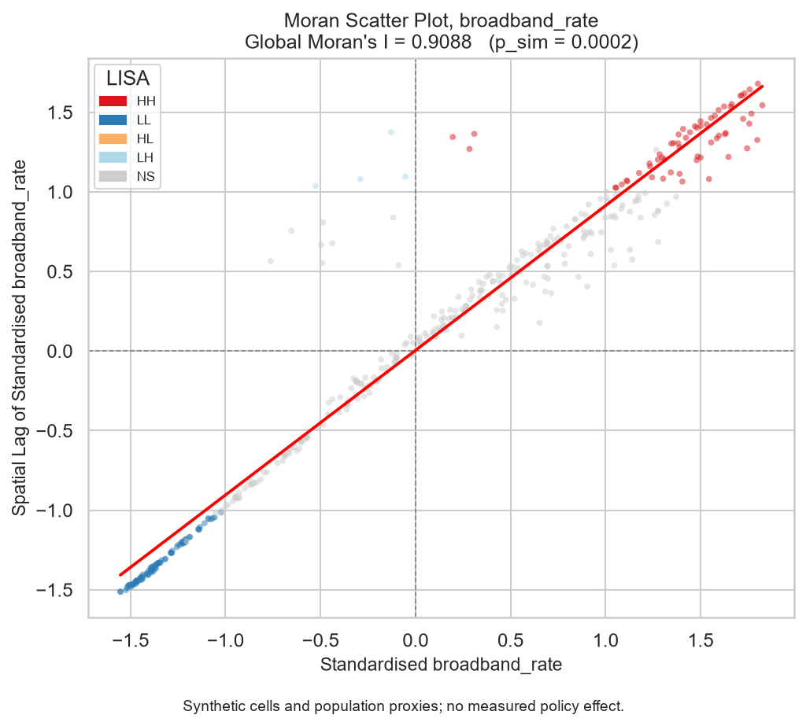
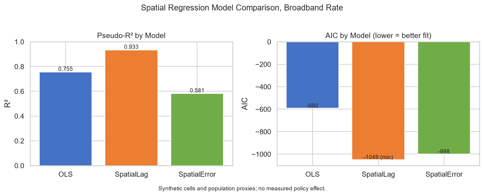

# Broadband targeting on a verified synthetic grid

Executed 3 November 2026. Artificial cells, adoption values and generated population proxies, not measured California households or program eligibility.

## Targeting denominator

All generated population in a cell contributes when adoption is below 65%. This is not a count of individual non-subscribers. The 258 below-threshold cells contain 521,152 proxy units. The primary queen analysis includes 85,741 (16.5%) and excludes 435,411 (83.5%). Outside-target units comprise 132,879 rural, 234,282 suburban and 68,250 urban units.

## Graph and inference

Neighbours derive from integer row and column coordinates, independent of floating-point polygon boundaries. Queen adjacency is primary; rook is a predefined sensitivity. Both graphs have one component, no islands, symmetric adjacency and exact row/ID alignment. Queen corner/edge/interior degrees are 3/5/8, with mean 7.41; rook degrees are 2/3/4, with mean 3.8. Row-standardised weights need not themselves be symmetric.

Synthetic generation and permutation seed: 42. Each spatial statistic uses 9,999 permutations. Local pseudo p-values are doubled from ESDA's directed folded tail, capped at one, then adjusted using Benjamini-Yekutieli across the full 400-cell family. This conservative choice avoids assuming independence or positive dependence. Raw and adjusted labels are both exported. Pseudo p-values remain Monte Carlo approximations; selection near the cutoff can vary with another seed.

The historical fragmented graph and unadjusted results are superseded; their bytes remain in Git history. Graph repair and inference changes both contribute to the new results.

| Analysis | Moran I | LL cells | Covered proxy | Coverage |
| --- | --- | --- | --- | --- |
| Queen, BY adjusted (primary) | 0.908807 | 90 | 85,741 | 16.5% |
| Rook, BY adjusted (sensitivity) | 0.919053 | 19 | 13,177 | 2.5% |
| Queen, unadjusted two-sided | 0.908807 | 116 | 122,601 | 23.5% |
| Rook, unadjusted two-sided | 0.919053 | 96 | 91,715 | 17.6% |

Global two-sided permutation pseudo p is 0.0002 for both adjacencies. Primary local counts: 90 LL, 60 HH, four LH and 246 NS. All selected LL cells are rural-labelled. The broad targeting distinction persists, but the selected set is highly sensitive to adjacency and multiplicity.

## Fitted models

OLS HC3 R2 is 0.7549, AIC -591.9. Primary Spatial Lag pseudo R2 is 0.9334, AIC -1049.36, rho 0.834741. Spatial Error pseudo R2 is 0.581, AIC -998.22. These are in-sample descriptors with different R2 definitions, not intervention effects or validated forecasts.

Subgroup graphs are induced subsets and can be disconnected, including an island in the rural subset. Their statistics in the JSON are exploratory, distinct from the verified connected full grid. The disadvantage index overlaps the generated drivers and is not independent corroboration.

## Reproduction and provenance

Run `.venv/Scripts/python.exe scripts/run_analysis.py` after installing `requirements.txt` in a Python 3.14 virtual environment. Run `.venv/Scripts/python.exe -m pytest tests -q -p no:cacheprovider`. `outputs/manifest.json` records source hashes, package versions, seed, parameters and output hashes. Counts and labels should match exactly in the pinned environment; model coefficients allow absolute tolerance 1e-6. Folium element IDs and timing metadata need not be byte-identical.

`outputs/cells.geojson` is the complete fixture source. The companion exporter validates manifest hashes before producing `broadband-synthetic.v2.json`. Version 1 is historical and is no longer loaded by the explorer. Source commit identifies the starting revision at the beginning of the analytical run.

Methods: [PySAL lattice conventions](https://pysal.org/libpysal/v4.14.1/generated/libpysal.weights.lat2W.html), [statsmodels multiple testing](https://www.statsmodels.org/dev/_modules/statsmodels/stats/multitest.html).

## Boundaries

The constructed mechanism intentionally creates spatial association and suppresses adoption in 15 urban cells. No causal policy effect, observed household estimate or actual subsidy eligibility follows. Authentic boundaries, observed denominators and an intervention evaluation remain necessary for empirical policy work. The hosted explorer updates through its existing publication workflow; deployment status must be verified separately.
