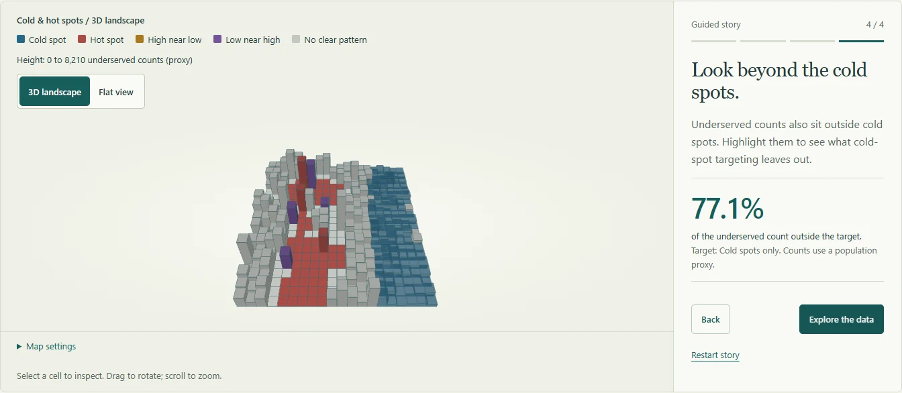
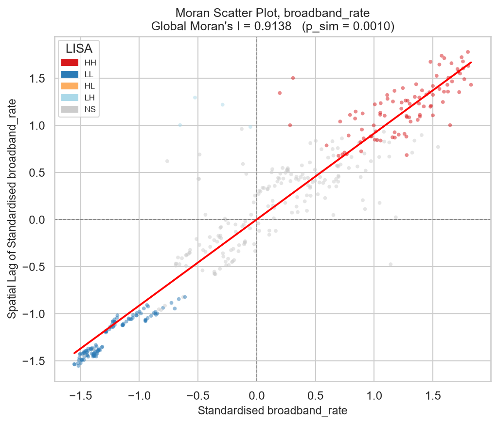
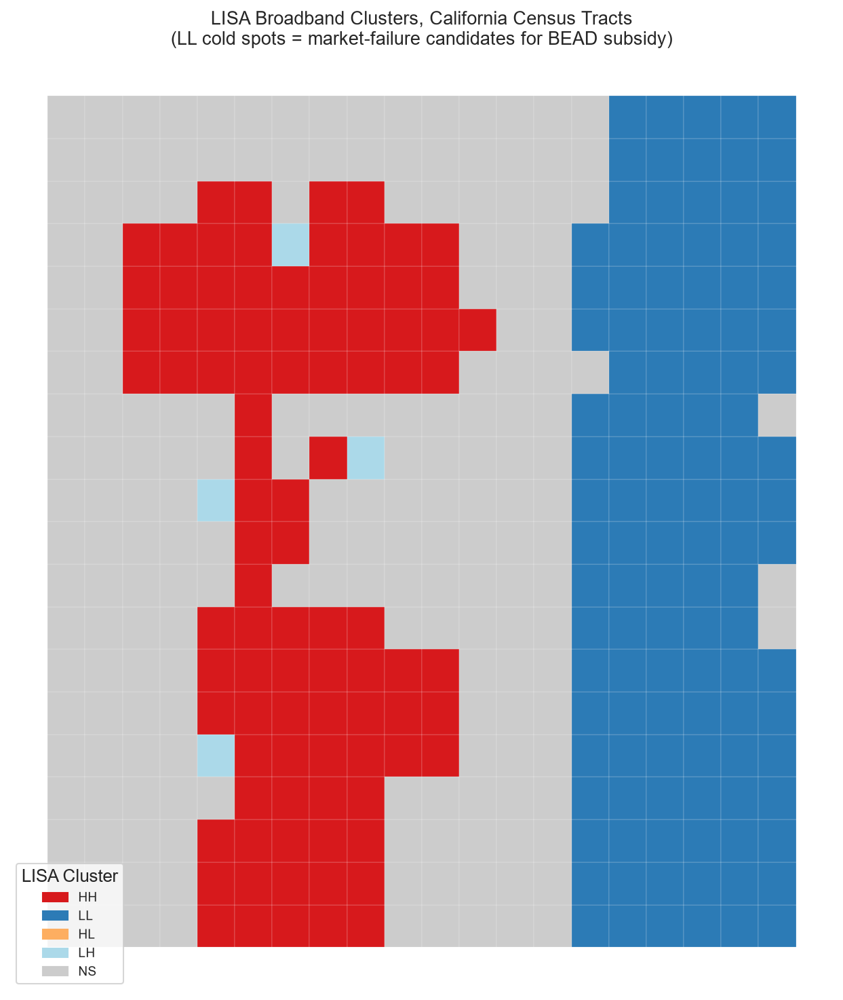
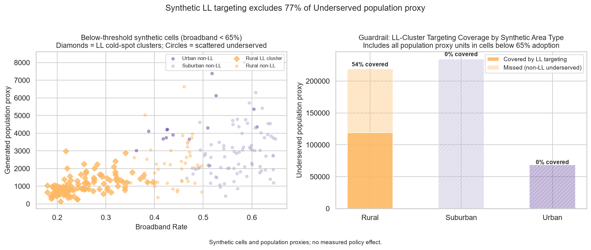

I built a spatial-analysis pipeline and interactive explorer to compare two targeting ideas: significant low-low clusters and all cells below a chosen adoption threshold. The published analysis uses 400 generated rectangles in an artificial 20 by 20 grid. They are not authentic Census tracts, and the counts are population proxies rather than observed California households.

The saved results illustrate the mechanics of spatial association, regression and targeting coverage. They do not diagnose actual market failure, establish subsidy eligibility or estimate policy effects.

## Explore the saved sample

Synthetic geography and population proxies. The final chapter shows the share of the defined underserved proxy outside the saved low-low target, not measured California households.

[Open Broadband Equity Landscape](https://jesco-tan.github.io/broadband-equity-landscape/) for a four-chapter walkthrough, 3D and flat views, cell inspection and targeting comparisons. The searchable HTML list and table fallback retain access without WebGL.

The explorer preserves all 400 records from a pinned analytical run, including full-precision local p-values and final classifications. It does not rerun spatial statistics. Its [source audit](https://github.com/jesco-tan/broadband-equity-landscape/blob/af1f1f96f94586fe4d5e584c481e5e9f7a4a2696/docs/source-audit.md) and [data validation record](https://github.com/jesco-tan/broadband-equity-landscape/blob/af1f1f96f94586fe4d5e584c481e5e9f7a4a2696/docs/data-validation.md) explain the fixture and proxy mapping.

## Constructed geography and association

Four synthetic centres drive a latent proximity field. That field influences generated income, education, population and adoption. Spatial smoothing deliberately creates association; 15 urban-labelled cells have adoption suppressed. Rural, suburban and urban are generated categories, not official Census classifications.

Synthetic scenario. Saved Global Moran I = 0.913804 and permutation pseudo p = 0.001 with 999 permutations. This describes constructed spatial association under the saved graph, not nearly perfect prediction or causal influence between actual places.

The contiguity audit found an important limit: the saved weights graph has 45 disconnected components and mean degree 4.25. Exact shared-vertex arithmetic on the exported polygons reproduces that graph and statistic. Floating-point construction of nominally shared borders appears to fragment the intended connected grid. A repaired grid would require a separately versioned analytical run; the explorer faithfully retains the historical one.

## Local patterns and fitted models

The saved local labels contain 113 LL cells, 92 HH cells, four LH cells and 191 nonsignificant cells. All LL cells have the rural label. Local tests use uncorrected pseudo p below 0.05, and their random seed was not recorded, so preserving the saved classifications is distinct from guaranteeing them in a new run.

Synthetic scenario under the historical graph. Blue marks 113 significant low-low cells and red marks 92 high-high cells. These labels identify relative spatial patterns; they do not establish service availability, household need or grant eligibility.

The project implements OLS with HC3 standard errors, Spatial Lag and Spatial Error models and subgroup summaries. Saved OLS R2 is 0.7549; Spatial Lag pseudo R2 is 0.9106, with AIC -922.24 versus OLS -591.90. These are in-sample fit descriptors. The spatial pseudo R2 is not the same metric as OLS explained-variance R2.

Rho 0.677804 describes fitted dependence. It does not identify how a subsidy changes neighbouring adoption. The generated disadvantage index is also not independent confirmation: it includes a broadband component calculated before the urban suppression step.

## What the 77.1% measures

A cell contributes its entire generated population to the underserved proxy when its adoption value is below 65%. Otherwise it contributes zero. This is not a calculation of population multiplied by the non-adoption rate and does not count individual non-subscribers.

Among the 258 cells below that threshold, the total proxy is 521,152 units. LL targeting includes 119,165, or 22.9%, leaving 401,987, or 77.1%, outside. The outside-target total includes 99,455 rural, 234,282 suburban and 68,250 urban proxy units.

Synthetic scenario. LL targeting includes 119,165 of 218,620 rural underserved proxy units, or 54.5%, and none of the 234,282 suburban or 68,250 urban units. Overall coverage is 22.9% of 521,152. The figure labels these generated population proxies explicitly.

This calculation shows that relative clustering and a fixed adoption threshold select different populations in this scenario. It does not show which infrastructure grants, vouchers or other interventions would work. The 65% setting is a scenario threshold, not a verified public-program eligibility rule.

## What this project demonstrates

The contribution is the implemented spatial workflow, explicit targeting denominator and interactive preservation of an auditable result set. The graph limitation, local-test multiplicity and constructed mechanisms remain material to interpretation.

An empirical extension would require authentic boundaries, observed household denominators, consistent data vintages, uncertainty handling, validated spatial weights and an intervention-evaluation design. A topology-corrected synthetic run should be published separately from this pinned historical fixture, with its neighbour graph and random seeds recorded.
